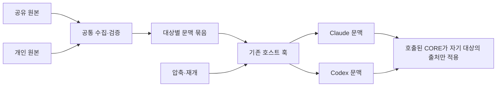

# SAGE overlay 통합 수정 설계 — 대상별 문맥 묶음

- 작성일: 2026-11-05
- 기준: v1.3.6 / `8e17a88`
- 위험 수준: L3
- 상태: **재설계 권고안. 구현 구조를 제안한 문서이며, 실제 압축·행동 검증 완료나 출시 승인 문서가 아니다.**
- 앞선 [전달 통합 초안](2026-11-04-overlay-delivery-unification-design.md)의 대안이다. [실현성 점검](2026-11-05-overlay-delivery-feasibility.md)은 당시 방식에 대한 유효한 관측으로 보존한다.

## 1. 이번에 고치는 것

한 번의 개발·검증·릴리스에서 다음을 모두 해결한다.

1. 공유 overlay 본문을 처음뿐 아니라 압축·재개 후에도 다시 전달한다.
2. 이번 대상인 **스킬 7종**의 개인 overlay 본문도 동일한 경로에서 자동 전달한다. 모델이 별도 CLI로 원문을 가져오는 것을 정상 경로로 삼지 않는다.
3. Fast의 cycle/plan/team에 표준+Fast overlay를 모두 적용한다. 표준 실행에는 Fast overlay를 적용하지 않는다.

Claude Code와 Codex를 함께 지원하고 기존 호출 방법과 Codex의 전역·로컬 스킬 설치를 유지한다. 작업용 worktree와 개인 파일의 체크아웃별 소유도 유지한다. 제품 코드는 아직 변경하지 않았다.

## 2. 이전 설계를 수정하는 이유

### 2.1 전달 전에 훅이 실행 대상을 알아야 한다는 조건을 없앤다

Codex 구조화 스킬 선택은 모델에 정상 전달되지만 현재 SessionStart/UserPromptSubmit에는 선택 정보가 없다. 따라서 훅이 현재 스킬 하나를 결정해야만 본문을 보낼 수 있는 방식은 기존 호출 전체를 지원하지 못한다.

사용자가 요구한 것은 **표준에는 표준 규칙, Fast에는 표준+Fast 규칙 적용**이다. 이전 초안에서 추가한 **표준 요청 본문 안에 Fast 출처가 0바이트여야 한다**는 조건은 이것보다 강하다. 이번 권고안은 이 추가 조건을 철회하고, 전달된 자료의 범위와 적용할 지침의 범위를 분리한다. 사용자가 이 추가 조건까지 요구했다고 표현하지 않는다.

### 2.2 여러 대상 본문을 보내는 비용과 위험을 숨기지 않는다

아래 방식에서도 여러 스킬의 overlay 본문은 같은 모델 문맥에 들어간다. 과거에 거절했던 전체 주입과 이 바이트 노출은 같다. 이름을 JSON으로 구분한다고 본문이 물리적으로 격리되거나 안전한 데이터로 변하는 것은 아니다.

차이는 **일곱 묶음을 모두 실행 지침으로 합치지 않고**, 대상별 대응표와 CORE 선택 규칙을 제공한다는 점이다. 범위 선택은 모델의 지침 준수에 속한다. 전달은 호스트 요청 본문으로 검증하고, 오적용은 별도 행동 시험으로 검증한다. 이 구분을 수용할 수 없다면 이번 안은 적합하지 않으며 기존 훅만으로 엄격한 대상별 사전 분리를 달성했다고 주장하지 않는다.

### 2.3 전달 수리와 완전한 사람 승인 인증을 분리한다

Fast open/convert가 인자 문자열을 수용한다는 관측은 맞다. 그러나 이는 overlay 없이도 가능한 기존 선택 출처의 한계다. 이것만으로 기존 구조 검증이 모두 부재하거나 이번 전달 수정에 서명·인증·승인 서버까지 필요하다고 결론 내리지 않는다.

Fast 분류는 **실제 위험도·허용 전이·프로필 하한·감사 결속·필수 단계·리뷰/종료 조건**을 독립 실행 코드가 보장하는지로 판단한다. 새 overlay가 만드는 구조적 우회가 있으면 반드시 최소 수정한다. 사람 동의의 진위, 테스트 증거 내용의 진실성, 의미적인 규칙 충돌을 해결했다고 주장하지 않는다. Fast에 새 본문이 들어오는 만큼 잘못된 자동 선택을 유도하는 행동 시험과 잔여 위험 평가는 별도로 수행한다.

## 3. 권고 구조



root 세션용 문맥 묶음에는 다음 스킬 **7종의 출처와 적용 대응표**만 넣는다.

- 표준: `sage-cycle`, `sage-plan`, `sage-team`, `sage-review`.
- Fast: `sage-cycle-fast`, `sage-plan-fast`, `sage-team-fast`.

worker 네 종류의 본문은 넣지 않는다. worker/reviewer는 기존 역할별 packet으로 해당 역할의 공유·개인 본문과 참조를 전달하는 계약을 유지한다. headless review의 CLI 자동 로딩과, host가 worker packet을 작성하며 loader를 호출하는 경로는 구분한다. 후자를 모두 native 자동화한 것으로 주장하지 않는다. 원 제보의 세 증상은 스킬 전달에 관한 것이므로 이번 필수 수리 범위를 7종으로 정하고, worker 개인 자동 공급 확대는 추가 후보로 평가한다. QA·framework·profile-modify 등 기존 blocked 자산도 새 묶음의 대상이 아니다.

source는 존재하는 원문마다 한 번만 싣는다. 최대 14개(7종 × 공유/개인)이며 Fast 상속은 본문 복제가 아니라 출처 참조 배열로 표현한다. 파일이 없는 슬롯과 공백뿐인 슬롯은 기존 없음 의미를 따른다.

예시 형태:

```json
{
  "schema_version": 2,
  "root": "검증한 현재 checkout",
  "role": "root",
  "generation": "schema/root/role과 정규화한 출처·대응표의 hash",
  "sources": {
    "skills/sage-team/shared": {
      "path": "sage/asset_overrides/skills/sage-team.md",
      "sha256": "실제로 전달한 문자열의 hash",
      "content": "표준 공유 원문"
    },
    "skills/sage-team/personal": {
      "path": "sage/asset_overrides.local/skills/sage-team.md",
      "sha256": "실제로 전달한 문자열의 hash",
      "content": "표준 개인 원문"
    },
    "skills/sage-team-fast/shared": {
      "path": "sage/asset_overrides/skills/sage-team-fast.md",
      "sha256": "실제로 전달한 문자열의 hash",
      "content": "Fast 공유 원문"
    },
    "skills/sage-team-fast/personal": {
      "path": "sage/asset_overrides.local/skills/sage-team-fast.md",
      "sha256": "실제로 전달한 문자열의 hash",
      "content": "Fast 개인 원문"
    }
  },
  "targets": {
    "sage-team": [
      "skills/sage-team/shared",
      "skills/sage-team/personal"
    ],
    "sage-team-fast": [
      "skills/sage-team/shared",
      "skills/sage-team-fast/shared",
      "skills/sage-team/personal",
      "skills/sage-team-fast/personal"
    ]
  }
}
```

예시는 설명용이다. 실제 배열에는 존재하는 출처만 넣고, 존재하지 않는 source 참조를 만들지 않는다. content를 제외한 metadata도 정규화하고 정해진 순서로 직렬화한다. 이 hash는 무결성·출처 관측이며 사람 승인 서명이나 실행 권한이 아니다.

## 4. CORE가 적용 범위를 결정한다

7종 각각의 CORE 앞부분에 자기 고정 id를 사용하는 짧은 공통 계약을 넣는다. 복잡한 셸 명령이나 호스트 전용 문법은 넣지 않는다.

1. 현재 checkout/root와 role이 맞는 문맥 묶음인지 확인한다.
2. 자기 id의 `targets` 출처만 순서대로 추가 지침으로 사용한다.
3. 다른 대상의 출처는 현재 지침으로 적용하지 않는다. 묶음의 존재를 스킬 호출·Fast 진입·전환·승인으로 해석하지 않는다.
4. 필수 CORE·프로젝트 정책·독립 gate를 우선한다. 공유 > 개인 우선순위를 유지하고, 뒤쪽 출처가 자동으로 앞쪽을 덮는다고 해석하지 않는다.
5. 현재 전달 본문을 사용한다. 별도 `overlay-local` 실행을 다시 요구하지 않는다.
6. root/role/현재 대상이 불명확하면 임의의 최근 대상을 고르지 않는다. 의미가 불명확한 경우는 실행을 보류하고 확인한다. 실제 압축 시험에서 정상적인 작업 재개가 이 상태로 반복해서 떨어지면 자동 복구 수용 조건의 실패다. 수동 재호출을 정상 복구라고 바꿔 PASS 처리하지 않는다.

선택 UI로 호출한 Codex도 이미 자기 스킬 본문을 받는다. 이 CORE가 자기 id를 안다는 것을 이용한다. **훅의 선택 정보 누락을 parser나 가짜 native 신호로 메우지 않는다.**

본문은 이미 문맥에 제공되어 있으므로 이 선택은 “원문을 가져오는 CLI를 실행할지 모델이 고르는” 종전 문제와 다르다. 다만 모델이 제공된 내용을 제대로 적용하는지는 여전히 행동 검증 대상이다.

스킬별 현재 대상 표지는 CORE 앞부분에 두고, overlay 본문을 CORE 앞으로 밀어 필수 STOP 절차를 잘라내는 개편은 하지 않는다. Codex 압축이 선택 스킬 원문을 다시 붙인다고 가정하지 않는다. 압축 뒤 모델이 현재 작업 범위를 이어받는지도 필수 행동 시험으로 확인한다.

## 5. Fast 자동 상속

| 호출 대상 | 적용 출처 순서 |
|---|---|
| `sage-cycle` | 공유 cycle → 개인 cycle |
| `sage-plan` | 공유 plan → 개인 plan |
| `sage-team` | 공유 team → 개인 team |
| `sage-review` | 공유 review → 개인 review |
| `sage-cycle-fast` | 공유 cycle → 공유 cycle-fast → 개인 cycle → 개인 cycle-fast |
| `sage-plan-fast` | 공유 plan → 공유 plan-fast → 개인 plan → 개인 plan-fast |
| `sage-team-fast` | 공유 team → 공유 team-fast → 개인 team → 개인 team-fast |

Fast 별도 파일이 없어도 표준 출처를 상속한다. 표준 파일이 없으면 Fast 출처만 적용한다. 둘 다 없으면 추가 지침이 없다. 표준의 역상속은 없다. `sage-review-fast`는 만들지 않는다.

Fast 대상의 자격을 먼저 확인하고, 각 상속 출처도 같은 경로/내용 검사를 통과해야 한다. Fast가 자격 미달인 개발 중간 상태에서 표준 출처를 Fast 대응표에 넣어 차단을 우회하지 않는다.

우산 스킬이 plan/team/review를 호출해도 **현재 호출 대상의 view**를 사용한다. 새로 들어간 child view에 부모의 전체 source 배열을 자동 추가하지 않는다. 반환 뒤에는 부모 CORE 문맥의 view를 사용한다. 이것은 실행 중첩 스택을 저장하는 새 서비스가 아니라 호스트의 기존 스킬/위임 동작에 대한 적용 규칙이다. 중첩·복귀가 실제로 구분되는지는 행동 시험의 출시 조건이다.

## 6. 언제 전달하는가

| 경계 | 동작 |
|---|---|
| SessionStart startup | baseline·입력 상태만 점검. 초기 본문은 이어지는 UserPromptSubmit에서 전달해 보통 첫 요청의 중복을 피함 |
| SessionStart resume/fork/compact | 현재 root의 검증된 묶음 전달. 재개가 새 사용자 입력 없이 이어질 수 있으므로 UPS가 반드시 온다고 가정하지 않음. 06 baseline과 compact reentry는 별도 결과로 보존 |
| UserPromptSubmit | 새 사용자 요청의 root에서 다시 검증·전달. 최초 Codex 선택 UI도 전체 묶음을 이미 받음 |
| 실제 스킬 재선택·암묵 선택 | 현재 묶음의 해당 view 사용. 원문 fetch를 정상 경로로 요구하지 않음 |
| worker/reviewer 위임 | 해당 역할의 기존 본문+참조 packet 사용. root 7종 묶음을 전파하지 않음 |

일반 startup은 UPS 한 번으로 공급한다. resume/compact/fork와 UserPromptSubmit이 같은 요청 앞에서 모두 실행되면 동일 출처가 두 번 전달될 수 있다. 이를 숨기거나, hook stdout을 냈다는 사실만으로 호스트가 중복을 제거한다고 주장하지 않는다. 같은 generation/출처는 같은 지침이며 두 번 실행하는 절차가 아니라는 계약을 넣는다. 첫 구현은 **전달 누락 방지를 우선하고 해당 경계의 최대 두 사본 비용을 시험에 포함**한다.

SessionStart에는 동일 요청의 turn id가 없는 경우가 있으므로, 가짜 식별자 결합으로 중복을 생략하지 않는다. 세션 이력/현재 target 저장 서비스를 만들지 않는다. 실제 비용이 허용 예산을 넘는다고 관측될 때만, 호스트가 제공하는 동일 경계 식별자를 이용한 최소 중복 억제를 추가 후보로 검토한다.

편집 반영은 다음 지원 경계다. 실행 도중 임의 시점의 hot reload는 보장하지 않는다. 새 경계의 입력 검증이 실패하면 새 정상 generation을 내거나 과거 generation을 최신으로 표시하지 않는다. 기존 메시지/압축 요약에 있던 사본까지 삭제할 수 있다는 주장은 하지 않는다.

## 7. 공통 수집·검증 계약

공유/개인을 합쳐 한 event당 하나의 collection을 만든다.

- 기존 root 경계, 경로/심볼릭 링크, canonical 파일명, CORE roster, 자격, 예약 토큰, 완화 lint, 전체 inventory 실패 의미를 유지한다.
- 한 번 읽은 정규화 문자열을 검사·hash·전달에 사용한다. 개인 원문은 표준 JSON escape로 직렬화하고 wrapper/임의 키로 승격하지 않는다. escaping을 prompt-injection 방어라고 부르지 않는다.
- 서로 다른 target마다 개인 전체 inventory를 반복해서 읽지 않는다.
- 수집 도중 파일/목록 변화를 발견하면 한 번 재수집하고, 다시 불안정하면 실패한다. 장기 lock/watch 서비스는 만들지 않는다.
- unknown/blocked/읽기 오류는 없음과 구분한다. 한 출처라도 실패하면 정상 catalog를 부분 출력하지 않는다.
- refs는 실제 그 경계에 공급한 본문의 hash다. 나중에 다시 스캔해 과거 작업의 참조를 덮지 않는다.
- 모든 root 출처가 실렸다는 참조는 **공급 목록**이다. 특정 작업이 모든 view를 적용했다거나 개인 지침을 준수했다는 실행 감사로 표현하지 않는다. 위임 packet은 실제 선택한 역할 출처를 별도 기록한다.

자료가 없는 설치에서도 root/role/generation과 빈 sources/targets를 가진 짧은 정상 없음 표지를 보낸다. 마지막 파일을 삭제한 뒤 과거 본문이 유효하다고 남지 않게 **현재 경계에 공급된 빈 상태가 이전 상태를 대체**한다. hash나 파일 mtime만으로 신구 순서를 추론하지 않는다. Fast source 파일이 존재할 때의 전체 자격/검증은 정상 없음 처리로 우회하지 않는다.

`blocked`는 자기 overlay의 등록/직접 적용을 허용하지 않는다는 뜻이며, 이 안은 다른 자격 대상 본문의 같은 문맥 노출까지 없애지 못한다. 대응표에 없는 `sage-profile-modify`/QA/framework는 catalog를 자기 추가 지침으로 적용하지 않는다. 이 노출 변화와 해당 blocked 호출에서 타 대상 규칙으로 프로필 floor를 낮추려는 반례도 시험한다.

## 8. 실패 처리: 요청 차단과 도구 차단을 구분한다

Claude SessionStart의 `continue:false`는 이 환경에서 요청을 막지 못했다. 새 설계는 여기에 중단을 맡기지 않는다.

1. SessionStart: catalog 생성 실패 시 본문 없는 진단만 내고, baseline·재진입 결과는 보존한다.
2. UserPromptSubmit: 같은 공통 validator로 검사하고 입력 오류/지원 예산 초과 시 native `decision:block`을 반환한다. 성공할 때만 catalog를 실어 보낸다.
3. PreToolUse: SAGE가 설치된 해당 checkout의 지원 도구 실행 전에 같은 validator를 호출한다. 오류가 있으면 native deny/exit 2로 실행을 보류한다. 기존 위험/phase 판정보다 앞에서 공통 입력 오류를 처리하되 기존 gate를 약화하지 않는다.

자동 압축 직후 사용자 입력 없이 모델 응답이 이어지면 텍스트 출력 한 번은 가능할 수 있다. 보장은 **실패 입력을 정상 본문으로 제공하지 않음 + 지원 도구의 제품 작업을 진행시키지 않음**이다. 모든 모델 요청 송신 0건이나 모든 자연어 출력 차단을 보장하지 않는다.

오래된 오류 latch를 신뢰하지 않고 해당 root의 입력을 직접 검사한다. 새 오류 상태 DB와 세션별 쓰기 의존을 만들지 않는다. 유효한 본문을 전송했다는 확인과 이후 입력의 현재 유효성 검사는 서로 다른 관측이다.

차단 범위와 복구를 분명히 한다.

- profile/manifest로 SAGE 설치가 확인된 checkout에만 이 검사를 적용한다. 비SAGE checkout은 pass-through다. 자연어 대화 자체를 도구 실행으로 취급하지 않는다.
- 해당 SAGE checkout에서는 잘못된 inventory를 가진 동안 지원 도구 실행이 보류될 수 있다. 이것은 기존 loader 오류보다 넓은 적용이므로 사용자 문서에 명시한다. 모호한 Bash를 일반적인 부작용 분류기로 판정하는 새 엔진은 만들지 않는다.
- **복구 기본값은 호스트 밖 터미널/에디터**다. UserPromptSubmit이 차단된 동안 같은 대화에 수리를 부탁하는 경로까지 자동 지원한다고 하지 않는다. 입력 파일을 고치고 `sage doctor`/검증을 실행한 뒤 다시 메시지를 보내면 현재 입력 재검사로 즉시 풀린다.
- 첫 구현에는 repair token, shell 복구 allowlist, 임의 쓰기 예외를 만들지 않는다. UserPromptSubmit부터 차단하면서 도구 예외만 여는 교착을 피한다. 같은 대화 안 수리가 실제 필요하다고 확인될 때 입력·도구 경계를 함께 좁혀 설계한다.
- 호스트가 가로채지 않는 임의 외부 실행까지 차단했다고 주장하지 않는다. 외부 수리를 이 guard가 차단하는 것도 아니다. 지원 도구 coverage를 실제 native 시험으로 확인한다.

stdout은 이벤트당 한 개의 host JSON으로 조립한다. declared-risk capture·baseline·재진입·overlay가 여러 JSON을 연속 출력하지 않도록 기존 handler의 출력 조립 지점만 정리한다. 기존 generated-artifact-write-guard의 host 등록 범위를 지원 PreToolUse 도구로 넓히고 dispatch 앞단에서 overlay 유효성을 검사하는 방식을 우선한다. 원래 순수 write guard 판정과 기존 phase gate는 유지하며 새 CORE hook id나 범용 셸 분석기를 기본 범위로 만들지 않는다.

root 마커가 진짜 없는 비SAGE checkout과, 마커가 있지만 손상된 SAGE checkout은 구분한다. 후자를 pass-through로 떨어뜨리지 않는다. validator 예외는 최상위에서 본문 없는 오류와 해당 native 차단으로 변환한다. 호스트가 hook을 아예 실행하지 않거나 timeout 후 계속하는 경우는 이 코드만으로 차단할 수 없으므로 설치/신뢰/버전/timeout 진단과 지원 조건을 명시한다. guard가 디스크 유효성을 검사했다는 사실은 모델 문맥에 catalog가 존재한다는 확인이 아니다.

## 9. 크기와 문맥 비용

선택된 Fast의 네 슬롯만 계산하던 예산은 더 이상 맞지 않는다. 이제 **존재하는 root source 전체 + 대응표 + wrapper + 같은 handler의 재진입 문맥**을 계산한다. 첫 요청의 두 handler 사본, CORE/일반 대화 여유도 별도로 측정한다.

Codex 기본 spill은 큰 본문 일부를 미리보기로 바꿨고, 47,700자 합성 입력은 명시 `additionalContextLimit=20000`에서 전부 전달됐다. 이 숫자를 제품 상한으로 확정하지 않는다. 새 묶음의 실제 payload로 호스트별 한도를 측정하고, 테스트가 통과하는 byte/token 지원 예산을 설치 설정과 doctor에 함께 기록한다.

출시 전 다음을 고정한다.

1. source별 최대 크기와 root catalog 총 지원 크기.
2. JSON escape를 포함한 최종 payload의 byte/token 계산 방식. 문자 수를 token 수로 동일시하지 않음.
3. host handler 한도와 대화 문맥 여유. 자동 압축 직후 재주입만으로 다시 압축되는 루프가 없는지.
4. 초과 입력의 본문 없는 진단: 총량·큰 source의 경로·지원 한도. 개인 본문은 로그에 남기지 않음.

원문 자동 축약, 끝부분 절단, preview/경로만 보내고 성공 처리, 자발적 CLI 읽기로의 조용한 후퇴는 하지 않는다. 실측 결과 전체 묶음 비용이 허용 불가능하면 이 권고안을 거절한다. 무제한 출력 설정으로 문제를 감추지 않는다.

## 10. 공유 디스크 사본과 설치

7종 스킬은 shared/personal 모두 **문맥 공급 경로**로 통일한다. shared만 렌더 말미에 남겨 잘린 옛 사본과 새 catalog가 다른 버전으로 움직이지 않게 한다.

- 표준/Fast 7종의 소유가 확인된 정상 관리 overlay span만 제거한다. CORE 본문과 그 밖의 사용자 바이트는 손대지 않는다. 손상 span/소유 불명 렌더는 충돌로 진단한다.
- shared/personal 원본 파일은 그대로 둔다. 개인 본문을 shared/global SKILL.md·manifest·영구 cache에 굽지 않는다.
- 각 CORE에는 프로젝트와 무관한 자기 id 선택 계약만 넣는다. Codex 전역 설치본에도 checkout의 개인 원문이 들어가지 않는다.
- worker 4종의 기존 물리 공유 합성과 본문+ref packet은 유지한다. headless reviewer의 CLI 1회 로딩 예외도 유지한다.
- `sync-overlays`, SessionStart L1, validate의 예상 블록 계산, install/upgrade 정상본 비교, write guard를 같은 전달 정책표로 정렬한다. “자격 compose”와 “스킬 디스크에 합성함”을 분리한다.
- upgrade는 기존 표준 overlay가 있는 프로젝트에서 첫 Fast 호출 시 상속된 source 경로와 대응을 본문 없이 안내한다. transaction/rollback은 기존 설치 구조를 사용한다.
- 구 CLI·구 hook·새 CORE가 섞인 설치는 자동 전달 검증 완료로 표시하지 않는다. 최소 지원 host/CLI와 필요한 hook 설정/신뢰 상태를 doctor가 진단한다. 훅 신뢰 정책을 임의 우회하지 않는다.

## 11. Root·역할·위임 경계

root는 실제 event cwd와 프로젝트/git 경계 또는 검증된 명시 root/handoff로 정한다. 전역 스킬 파일 위치와 최초 cwd를 현재 checkout으로 대신하지 않는다. 기존 `sage-hook` root 우선순위에서 이 경로에 필요한 최소 보완만 한다.

- 다른 checkout/worktree의 개인 파일을 자동 승계하지 않는다. 새 worktree에 파일이 없으면 정상 부재다.
- catalog의 root와 현재 작업 root가 다르면 적용하지 않고 새 root의 지원 경계에서 다시 전달한다.
- root용 일곱 스킬 본문은 worker/reviewer packet에 붙이지 않는다.
- SAGE가 실행하는 headless reviewer/worker는 기존 런처의 명시 역할 packet 표지를 사용해 root catalog 중복 공급을 억제한다. 역할 packet 경계에서 필요한 최소 표지만 추가할 수 있다.
- native subagent의 generic agent_type만으로 leader/implementer/reviewer를 추측하지 않는다. 명시 역할이 없는 자식에게 root catalog를 **새로 추가하지 않는다**. 부모 문맥을 상속한 fork의 과거 본문까지 지웠다는 뜻이 아니다. 새 packet의 출처와 상속된 과거 문맥을 구분해 시험하고 보고한다.
- 자식 자체 압축이 기존 packet 본문을 유실하는 반례가 나오면 해당 역할·호스트의 재전달 연결을 추가한다. 범용 모든 agent 프레임워크 지원으로 확대하지 않는다.

## 12. Fast 자격을 여는 조건

단순히 allowlist에 세 id를 넣지 않는다. 세 id별 primary 기여를 기존 독립 oracle과 적대적 시험에 연결한 BACKING을 추가한다.

| 보호 대상 | 재사용 후보 |
|---|---|
| 프로필 opt-in·유효 Fast 상태·감사/계획 결속 | `_fast_cycle_state`, CLI profile/plan 검사 |
| 리뷰 수준별 rounds/lenses 하한 | `_fast_policy_floor_issue`, review/close 검증 |
| fresh composite / converted 단계 면제의 제한 | `_fast_covers_required`, 전환 provenance 검사 |
| 실제 risk와 Fast review level 분리, 실제 risk 하향 금지 | effective risk 판정 및 plan/audit 일치 검사 |
| 검증·리뷰·보고·종료 조건 | acceptance/report/loop audit 및 CI authority |

악성 shared-standard/shared-Fast/personal-standard/personal-Fast 각각에서 phase 생략, 손상 감사, 잘못된 stem/root, risk 불일치, 최소 lens/round 감소, fake close, 다른 review run 재사용, 필수 acceptance 누락을 유도한 상태를 넣는다. **해당 제어가 overlay 텍스트를 읽지 않고도 거부하는지** 확인한다. 기존 source가 첫 Fast 호출에 상속되는 경로도 포함한다.

본문이 제공됐다는 사실, CLI 인자가 맞다는 사실, 사람이 실제 동의했다는 사실은 별개다. `--confirmed-by` 문자열을 사람 인증으로 표시하지 않는다. 기존 CLI 인증 한계만으로 범용 승인 기록 시스템을 필수화하지 않고, 실제 새로운 구조적 우회는 자격 개방 전에 최소 수정한다.

반면 새 catalog 때문에 **요청하지 않은 Fast 자동 선택/전환이 재현되면 A3 실패로 출시를 차단**한다. 구조 gate가 GREEN이라는 이유로 그 행동 회귀를 자동 수용하지 않는다. scope 계약/최소 제어를 고쳐 재시험하고, 고칠 수 없으면 이 catalog 안을 거절한다. 이번 설계에 A3를 면제하는 기본 경로는 없다. 기존의 선택 출처 한계는 정확히 보고하되 새 노출과 비교하지 않고 delta=0이라고 단정하지 않는다.

## 13. 필수 수정과 추가 후보

| 구분 | 포함 범위 |
|---|---|
| 필수 M1 | 공통 한 번 읽기·검증·출처 hash·root scope catalog |
| 필수 M2 | SessionStart/UserPromptSubmit 자동 전달, 실제 compact/resume 재전달, 7종 CORE 선택 계약 |
| 필수 M3 | Fast 세 대상 BACKING·적대적 시험·표준/Fast 네 슬롯·분류/쓰기 가드 정렬 |
| 필수 M4 | 7종 legacy 공유 span 제거, install/sync/validate/L1/업그레이드/롤백과 전역 Codex 호환 |
| 필수 M5 | native 입력/도구 실패 처리, 외부 수리 후 재진입, 단일 응답 조립, root/역할 경계 |
| 필수 M6 | 크기/성능/압축/역할 혼입/실제 모델 행동 acceptance와 문서 |

추가 후보는 재현된 완료 조건 장애에만 승격한다.

| 후보 | 위험·중요도 / 현재 근거 | 처분 |
|---|---|---|
| Fast 사람 선택 출처 강화 | 영향 높음 / 문자열 한계는 기존 CLI에서 재현 | 별도 인증 체계 제외. 새 노출과 우회를 비교하고 실제 필요한 최소 부분만 재검토 |
| boundary 중복 억제 | 문맥 비용 중~높음 / 두 훅 전달이 가능함 | 첫 구현은 중복 비용 포함. 예산 장애가 실측될 때만 작은 연결 검토 |
| worker 개인 자동 공급·자체 압축 복구 연결 | 역할 유실 영향 중~높음 / headless review 자동 로딩은 존재, 일반 worker의 loader 호출은 host 지시 경로 | 7종 스킬 수리의 필수 항목으로 확대하지 않음. 기존 packet 회귀는 필수 검사. 대상 역할의 실제 누락·중요도·기존 정상 경로 회귀가 확인되면 해당 경로만 승격 |
| 같은 대화 안 입력 수리 | 복구 편의 중간 / UPS 차단과 도구 예외의 교착은 설계상 확인 | 기본은 외부 터미널 수리. 수리용 shell allowlist/승인 서비스 제외 |
| CORE 전체 축약·외부화 | 회귀 높음 / 이번 방식은 머리로 overlay를 밀지 않음 | 제외 |
| 활성 target 영수증/스택 DB·transcript parser | 상태 오매핑 높음 / 새 방식은 선행 target 감지 불필요 | 제외 |
| 개인 영구 렌더·전용 런처·프록시·Codex fork | 소유/운영/호환 변경 높음 | 제외 |
| 요청 자산만 inventory 검사 | fail-closed 완화 높음 | 제외. 기존 전체 검사 유지 |

## 14. 구현 파일 경계

정확한 새 내부 함수명은 구현 계획에서 고정한다. 기존 모듈의 역할을 다음처럼 제한한다.

| 경계 | 파일/영역 |
|---|---|
| 순수 source/target 구조·순서·hash·직렬화 | 신규 `sage/overlay_delivery.py` 후보. 기존 common/local/materialize 검사 경로 재사용 |
| 자격 및 물리 합성 정책 | `sage/overlay_classify.py`, `overlay_materialize.py`, 공통 source 검사 경계 |
| event 수집·한 응답 조립·오류 검사 | `scripts/sage_harness/hooks/runtime/hook_runtime.py`, `run_hook.py`, `io_claude.py`, `io_codex.py` |
| hook 진입/root/fail-closed roster | `sage/hook_entry.py` 및 기존 host 설정 생성 경로 |
| 설치/정상본/출력 한도 | `sage/commands/install.py`와 기존 설정·진단/doctor 경로 |
| CORE 계약 | `templates/core/skills/` spec과 `templates/core/framework/.claude/skills/<id>/SKILL.md` 렌더 템플릿의 일곱 대상 |
| Fast backing/회귀 | overlay classification/backing, fast-cycle/convert, runtime/entry/settings/install 관련 기존 test suites와 필요한 새 delivery test |
| 사용자 안내 | 한/영 CLI·troubleshooting·architecture/설치 안내의 해당 계약 절 |

framework 전체를 이 기능 때문에 다시 생성하거나 unrelated hook을 재설계하지 않는다. standalone 순수 gate에 SAGE package import를 새로 강제하지 않는다. 배포 runtime이 source validator를 사용할 수 없는 조합은 정상 성공으로 보지 않고 설치/지원 버전 문제로 진단한다.

## 15. 완료 조건과 검증 순서

먼저 두 모델의 실제 요청 본문에서 catalog 전달을 확인하고, 그 다음 실제 모델 행동을 확인한다. 한쪽 결과를 다른 쪽이나 다른 버전의 근거로 재사용하지 않는다.

| ID | 수용 조건 |
|---|---|
| A1 | Claude/Codex의 직접·구조화 선택·암묵 진입에서 존재하는 공유/개인 원문 앞·중간·끝과 hash가 실제 요청에 있음. CLI 자발적 fetch 없이 성립 |
| A2 | 양 호스트의 수동·자동 압축 및 resume 다음 제품 작업에서 같은 전달 계약이 유지됨. 원문이 요약에 남았다는 이유만으로 재전달 PASS 처리하지 않음 |
| A3 | 실제 모델의 표준 호출이 해당 두 슬롯만, Fast가 해당 네 슬롯을 적용. catalog 안의 다른 target/다른 root 규칙을 실행하거나 Fast를 자동 개방하지 않음 |
| A4 | 중첩 plan/team/review와 반환, 기존 worker·headless reviewer에서 역할/출처가 섞이지 않고 필요한 본문이 있음 |
| A5 | 오류 입력·초과 크기·공유 L1 오류가 부분 정상 catalog나 지원 제품 도구 실행으로 이어지지 않음. 마커 손상/예외도 동일 처리. 외부 입력 수리 후 다음 메시지가 latch 없이 정상 복구됨 |
| A6 | Fast 분류 backing과 악성 네 슬롯, 기존 표준 출처의 최초 상속, fresh/convert/review/close 회귀가 통과 |
| A7 | Codex global/local, 두 checkout/worktree, upgrade/rollback, clean wheel consumer에서 개인 비노출·원본 보존·정상본 비교·sync 멱등성이 통과 |
| A8 | 최대 지원 입력·두 hook 사본·여러 turn 누적·한국어/escape 확장·CORE 및 대화 여유에서 spill/잘림/연속 압축 루프 없이 동작. 확정 한도·버전·실측 비용을 기록 |

행동 smoke에는 충돌하지 않는 target별 marker 규칙과, 다른 target에만 둔 유혹 규칙을 함께 넣는다. 정상 세션에 Fast text가 **전달되는 것은 이 설계의 예상값**이다. Fast 행위를 적용하는 것은 실패다. 비교 결과는 모델·버전·입력·압축 경계와 함께 보존하고 완전 준수 보장으로 과장하지 않는다.

현재 완료된 것은 기존 방식의 호스트 반례 및 기존 기준선 92 PASS와 아래 추가 관측이다. 위 A1~A8은 새 방식의 수용 조건이며 아직 모두 통과하지 않았다. 특히 실제 자동 압축·복귀 행동·큰 catalog 비용을 핵심 검증으로 남긴다. 단위검사만으로 출시하지 않는다.

### 새 권고안의 최소 실현성 관측

실제 설치된 CLI와 합성 14-source catalog를 로컬 모의 모델에 연결했다. 제품 collector/CORE를 구현한 시험은 아니다.

- Codex app-server에서 같은 사용자 Text와 서로 다른 구조화 `Skill`을 보낸 두 요청 모두 catalog의 14개 본문을 받았다. native 표준/ Fast 스킬 본문은 각각 올바르게 선택됐다. 훅이 선택 id를 몰라도 공급할 수 있음을 확인했다.
- Codex에서 두 thread 각각 `thread/compact/start`를 실제 실행했고, `SessionStart source=compact`가 발생했다. 이어진 요청에도 catalog 14개 본문이 들어갔다. 이는 모의 요약 응답을 사용한 **native 수동 압축 경로**의 관측이며 실제 모델 요약·자동 압축·의미적 scope 복구의 증거는 아니다.
- Claude startup 요청에도 같은 14개 본문이 들어갔다. Claude의 실제 압축 통합 및 실제 모델 적용은 이 관측에 포함되지 않는다.
- startup SessionStart에서는 본문을 생략하고 UPS에서만 내보내는 별도 시험에서도 Claude 1개 요청, Codex 구조화 선택 2개 요청 모두 14개 출처를 **각각 catalog 한 사본으로** 받았다. resume/fork/compact까지 같은 생략 규칙으로 확대하지 않는다.
- [격리 원자료](/Users/sejon/project/sage_project_worktree/overlay-catalog-redesign-neptj1og)와 [최소 probe 스크립트](/Users/sejon/project/sage_project_worktree/overlay-catalog-redesign-neptj1og/probe.py)를 보존한다. 출력 본문을 보냈다는 사실을 규칙 적용 PASS로 세지 않는다.

별도로 실제 모델에 작은 합성 scope 시험을 수행했다. native 스킬의 selector가 자기 target을 가리키고, source별로 서로 다른 결과 token을 요구하는 fixture다.

| 호스트/실제 모델 | 표준 | Fast | 관측 범위 |
|---|---|---|---|
| Codex 0.166.0 / `gpt-6.1-sol` | 두 출처만 반영 | 대응 네 출처만 반영 | 구조화 Skill 입력, 각 1회 |
| Claude 2.1.318 / `claude-opus-5-5` | 두 출처만 반영 | 대응 네 출처만 반영 | native Skill 도구로 합성 스킬 호출, 각 1회 |

이 네 표본은 실제 모델이 공급된 묶음에서 범위를 선택할 수 있다는 작은 근거다. 제품 7종 CORE·악성 본문·압축 뒤 의미 복구·반복 신뢰도 시험을 대체하지 않는다. Claude의 첫 tool-less slash 시도는 합성 스킬이 활성화되지 않아 **유효 scope 표본에서 제외**했고, native Skill 도구 경로로 다시 시험했다. 그 실패 자료도 원자료에 남긴다. 자세한 review/실행 신원은 [새 방식 검토 기록](2026-11-05-overlay-catalog-review.md)을 따른다.

## 16. 실행과 공수

L3의 00~06 기록, 구현, 일반 검증, 독립 렌즈 리뷰와 반박·처분·수정 확인을 유지한다. 엔진이 자기 `sage review-loop`/gate/waiver로 자기 변경을 승인하지 않는다. 기존 설계 리뷰 3회와 실현성 자문을 구현 후 05 리뷰로 세지 않는다. 커밋·푸시·배포는 별도 승인 범위다.

개발은 하나의 브랜치·통합 변경으로 진행하되 내부 검증 순서는 다음과 같다.

1. 문맥 묶음과 적용 범위의 최소 native/실제 모델 smoke, 최대 크기 계측.
2. 공통 collector와 일곱 view, CORE 계약·Fast backing.
3. runtime 전달·실패·복구, 설치·마이그레이션·호환 연결.
4. 전체 acceptance·package consumer·독립 L3 리뷰와 필요한 재작업.

첫 단계에서 새 방식의 핵심 반례가 확인되면 해당 원인을 수정하고 재시험한다. 검증에 실패한 성격을 이름만 바꿔 유지하거나 일부 항목을 빼고 통합 완료하지 않는다. **착수 전 실현성 확인과 구현 후 acceptance를 구분**한다. 사용할 수 있는 호스트 채널과 작은 scope 동작을 먼저 확인하고, 아직 구현하지 않은 collector/전체 설치/적대적 테스트의 A1~A8을 구현 이전에 이미 통과했다고 요구하거나 주장하지 않는다.

공수는 **숙련 개발자 1인의 순작업 기준 약 8~13인일**을 설계 기반 추정으로 둔다. 구현 4~6, native/압축/설치/행동 검증 2~4, L3 리뷰·재작업·문서 2~3의 합이다. 실측 공수가 아니며 기존 분석 소요와 CI/기기 대기는 제외한다. 큰 catalog 비용이나 역할 혼입을 해결하기 위해 별도 호스트 계층이 필요해지면 이 추정을 유지하지 않는다.

## 17. 현재 판단

이 방식은 **훅이 Codex의 현재 선택을 알아야 한다는 불가능한 전제 없이**, 현재 확인한 자동 문맥 전달 채널로 원문을 공급할 수 있는 후보다. 사람 승인 진위의 일반 문제를 이번 개발 전체의 선행 조건으로 삼지 않는다.

맞바꿈은 분명하다. 다른 root 스킬의 지침 원문도 같은 모델에 노출되고, 적용 분리는 CORE 지침과 행동 검증에 의존하며, 총 입력 비용이 커진다. 이 맞바꿈을 허용하는 설계로 범위를 명시했으며 실제 검증 통과 전 완성·보장·승인으로 표현하지 않는다.

공식 참고: [Codex hooks](https://learn.chatgpt.com/docs/hooks), [Codex skills](https://learn.chatgpt.com/docs/build-skills), [Claude hooks](https://code.claude.com/docs/en/hooks), [Claude skill lifecycle](https://code.claude.com/docs/en/skills#skill-content-lifecycle).
